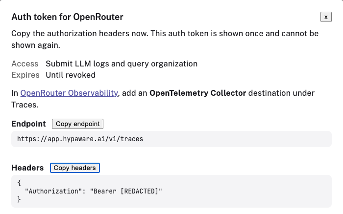

# OpenRouter Broadcast

Connect OpenRouter to HypAware to see your workspace's model requests in
**Sessions** and their token usage in **Usage**. OpenRouter sends traces directly
to your HypAware server. Collection starts with new requests once you save the
destination. There is no client software to install or history import to run.

## 1. Create a credential in HypScope

You'll need a verified OpenRouter account with access to the workspace's
**Observability** settings. For an organization workspace, sign in as an
OpenRouter org admin. In HypScope, sign in as an admin of the organization
that should receive the traces. If you host HypAware yourself, your server
must have OpenRouter ingestion deployed and be reachable from OpenRouter
over public HTTPS.

1. Open **Service accounts** in [HypScope](https://app.hypaware.ai/service-accounts)
   and choose **Connect OpenRouter**.
2. Under **Service account**, select **Create a new service account**, then
   **Create account and auth token**. Give the account a recognizable name
   and choose **Create account**. To use an existing account, select an
   enabled one and choose **Create OpenRouter auth token**.
3. Enter an **Auth token name** that identifies this destination, such as
   `OpenRouter production`, and choose **Create auth token**.
4. Keep the dialog open. You'll use **Copy endpoint** and **Copy headers** in
   the next step. HypScope shows the secret only once. If you close the dialog
   before copying it, revoke the unused token and create a replacement.

The headers contain a **HypAware service-account token**. It can submit LLM
logs and query your organization until revoked. Paste it only into the intended
destination. Your **OpenRouter API key** stays with the application that makes
model requests.



## 2. Configure the OpenRouter destination

1. In a second tab, open [OpenRouter Settings > Observability](https://openrouter.ai/settings/observability)
   in the workspace that owns your application's API key. Enable Broadcast.
   Under **Traces**, open the editor for **OpenTelemetry Collector**.
2. Paste the full **Endpoint** from HypScope, including `/v1/traces`. For
   hosted HypAware it is `https://app.hypaware.ai/v1/traces`. Paste the
   complete JSON object from **Copy headers** into **Headers**. Leave
   **Send OTLP metrics** off. HypAware reads usage from the trace itself.
3. Select the API key you will use for verification. An empty include list
   allows all workspace keys, and an excluded key is always skipped. Set
   sampling to **1.0 (100%)** for setup. You can lower it later. With a
   session ID, OpenRouter samples all requests in that session together.
4. Turn on **Privacy Mode** if you want usage without prompt or response
   text. OpenRouter still sends model, timing, reported tokens and cost,
   as well as custom metadata. Keep sensitive text out of metadata. With
   Privacy Mode off, exported inputs and outputs can appear in Sessions.
5. Optionally enable **Cost allocation**. HypAware can record a USD cost
   when OpenRouter supplies a reconciled breakdown whose line items add up
   to the charge. A request can have token usage with no priced cost. A
   missing cost does not mean the request was free.

## 3. Test the connection and save it

1. Choose **Test Connection**. Success means OpenRouter reached the endpoint
   and HypAware accepted the credential. This check sends no model request
   and creates no session.
2. Choose **Send Trace** to send OpenRouter's built-in sample. Seeing that
   sample in HypScope confirms delivery and storage. It can contain canned
   prompt and response text even with Privacy Mode selected.
3. **Save** the destination and make sure it is enabled. Once the headers
   are saved, choose **Done** in HypScope. Keep the setup page open for the
   receipt check.

## 4. Verify a real request in Sessions and Usage

1. Make a chat request through your application's OpenRouter client using
   the selected API key and a model available to your workspace. Use a
   harmless prompt like `Reply with the word maple.` Set the request body's
   `session_id` to a unique value such as `setup-check-nov19-01`, or send
   that value in the `x-session-id` header. Note the time and model.

   For example, with your selected OpenRouter key in `OPENROUTER_API_KEY`,
   replace `MODEL_ID` with an available model ID and send one request:

   ```sh
   curl --fail-with-body https://openrouter.ai/api/v1/chat/completions \
     -H "Authorization: Bearer $OPENROUTER_API_KEY" \
     -H 'Content-Type: application/json' \
     -d '{
       "model": "MODEL_ID",
       "session_id": "setup-check-nov19-01",
       "messages": [{"role": "user", "content": "Reply with the word maple."}]
     }'
   ```

   A completion confirms the model answered. The next steps check whether
   HypAware received that same request.

2. In HypScope, choose **Check again** if the setup page has stopped checking.
   **Receiving OpenRouter requests** means HypAware stored a record using
   this new token. The sample can trigger that message too. Choose **View
   collected sessions**, open the session for your test call and match the
   time and model to the request you just made.
3. Open the request. With Privacy Mode on, look for **OpenRouter did not
   export message content** and check that usage is present while the prompt
   and response text are absent. This verifies what HypScope stored for
   your real call. Privacy Mode controls what OpenRouter sends to this
   destination. Model-provider retention is a separate setting.
4. Under **Service accounts**, open the account and choose **View usage**.
   Use a date range that includes your test and check the model and tokens.
   **View sessions** on the same account takes you back to its requests.

Send a second request with the same session ID to see the calls grouped under
one session for that service account. Each call keeps its own exported input
snapshot and response. If your application resends conversation history,
earlier messages can appear in both snapshots. Without a session ID, HypAware
groups by trace ID. Broadcast sees what reached the model. It cannot tell you
which tools ran on the client, which local files changed, or what was committed
to git.

If the sample appears but your request does not, check that you saved and
enabled the destination in the same workspace as the calling key. Recheck the
key filters and sampling, then send a new request. If **Test Connection**
fails, check the full HTTPS URL and the copied headers, and confirm the
account and token are still active.

## Stop collecting

- To pause this destination, disable it under **Traces** in OpenRouter.
- To invalidate its credential, open the service account in HypScope, find
  the named auth token, choose **Revoke**, then confirm **Revoke auth token**.
  Other tokens on the account keep working.
- To retire the whole account, choose **Disable account** and confirm. This
  permanently disables the account and stops all its tokens on their next
  request. Previously collected sessions and usage remain available.

For more about destination settings, see
[OpenRouter's OpenTelemetry Collector guide](https://openrouter.ai/docs/guides/features/broadcast/otel-collector)
and [Broadcast options](https://openrouter.ai/docs/guides/features/broadcast).
