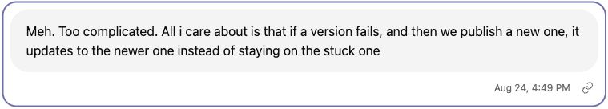

# Add decision context to every pull request

Give reviewers a short introduction before they open the diff. The Action
finds the development conversation, checks what shipped, and puts the
reason for the change and its key decisions at the top of the PR
description. Each claim links to the messages that support it.

## What a reviewer would read

For [HypAware PR #1013](https://github.com/hyparam/hypaware/pull/1013), the
discovery script checked two sessions on the PR branch and found seven
candidate messages in one of them. All seven went into generation
alongside the PR title and 17 code and test patches. The resulting
97-word section cites six messages. This example comes from a local replay.
The live PR contains an earlier draft based on five hand-selected messages.

> **Why this PR exists.** HypAware needs automatic updates, including a way for a version that fails to boot to pick up a newly published fix rather than remain stuck.
>
> - **Reuse global npm installs.** The user chose installing with `npm install -g` and restarting through the service manager, rather than maintaining separate versioned installs.
> - **Recover forward, not backward.** The user rejected rollback complexity. The implementation checks before kernel boot so a failing release can still find a newer fix.
> - **Limit registry checks.** The assistant proposed daily checks, or hourly after an unsuccessful boot, to find fixes without hammering npm; those intervals shipped.

In a generated PR, each citation opens the original message in HypAware.
Only people with access to the recording can follow it, so we’ve omitted
the private links here. This is the developer’s message behind the decision
to recover forward.



## How HypAware finds the decisions

HypAware looks for chats on the PR's source branch around the time it opened
and checks up to four, most recent first. If none match the branch, it looks
for a single chat that pushed it, including with `git push -q`. It can also
recognize a branch created through the Codex GitHub connector when the
repository, branch name, and commit all match the PR.

Words from the PR title lead HypAware to the developer's request. For a
release PR, that request can be a `$prepare-release` invocation. If the work
started in another Codex chat, HypAware can follow a verified handoff within
the same repository and cite the original `/handoff` message when it names the
issue in the PR title. A reply like “go with option A” brings in the agent's
proposal so a reviewer can read both sides of the decision.

The model uses those messages for intent and the GitHub changes to check
what shipped. For documentation or test changes alone, it gets the file
names and change types. A guide can include screenshots under `docs/`.
The Action checks each citation, then puts the section above the author's
latest text.

## When the recording arrives after the PR

GitHub can start the Action before HypAware receives the push. If an
automatic run finds no candidate messages, it waits three minutes and
tries once more while the same PR revision is open. On PR #3038, the
first lookup found zero sessions. The retry found the developer's message
and the Action added the cited section above the original description.
[Read PR #3038](https://github.com/hyparam/hypaware/pull/3038) · [See the automatic run](https://github.com/hyparam/hypaware/actions/runs/44575547237)

If a PR still has no section, open **Actions → PR decision context** and
select its run. The **Update cited PR context** log gives the session and
message counts for each lookup. The summary tells you whether discovery
found a session, found a developer request, or had enough evidence to
explain the change. Once a recording is available, you can run the workflow
manually from the default branch with the open PR's number.

## Install the Action for every PR

1. In your repository's **Settings → Secrets and variables → Actions**,
   set `HYP_PR_CONTEXT_TOKEN` to an agent token for the HypAware organization
   that records your team's sessions. Add `OPENAI_API_KEY` for generation. The Action
   sends the selected messages and PR changes to OpenAI. It uses
   `gpt-5-mini` by default. To choose another compatible model, set the
   repository variable `HYP_PR_CONTEXT_MODEL`. Anyone who can read the PR
   can read its generated section. The citations open for people with
   access to the recording. [Mint a HypAware token](../MCP.md#mint-an-agent-token)
2. From the root of your repository, download the workflow and both scripts
   from the same HypAware revision. This version includes automatic discovery and optional
   model recording. [Workflow](https://github.com/hyparam/hypaware/blob/69400ce8107e440027bc63772abd40043f769900/.github/workflows/pr-context.yml) · [Scripts](https://github.com/hyparam/hypaware/tree/69400ce8107e440027bc63772abd40043f769900/.github/hypaware-pr-context)

   ```sh
   src=https://raw.githubusercontent.com/hyparam/hypaware/69400ce8107e440027bc63772abd40043f769900/.github
   curl -fsSL --fail-early --create-dirs \
     -o .github/workflows/pr-context.yml "$src/workflows/pr-context.yml" \
     -o .github/hypaware-pr-context/discovery.mjs "$src/hypaware-pr-context/discovery.mjs" \
     -o .github/hypaware-pr-context/describe.mjs "$src/hypaware-pr-context/describe.mjs"
   ```

3. Commit the three files and merge them into your default branch with
   GitHub Actions enabled. The workflow requests `contents: read` and
   `pull-requests: write`. It runs the installed script from the base
   repository and reads proposed changes through the GitHub API. For a
   fork PR, it searches recordings for the fork's repository and branch.
   [GitHub's pull request event reference](https://docs.github.com/en/actions/reference/workflows-and-actions/events-that-trigger-workflows#pull_request_target)

Open a PR, reopen one, or push a new commit to trigger **PR decision
context**. On the PR's **Conversation** tab, look for **Decision context
from HypAware** at the top of the description. Later runs refresh that
section and preserve the author's text below it.

## Use the model recordings to improve the Action

When a PR introduction misses the point, open the model call that wrote it.
In HypAware you can read the writer's instructions, the source messages and
changes it received, and its visible reply. If the developer's decision is
missing from the input, improve discovery. If the decision is there and the
draft overlooks it, try a more specific instruction and compare the next run.

From the root of your repository, use the HypAware CLI signed in to your
organization and the GitHub CLI signed in to the repository. This command
saves a dedicated recording credential as an Actions secret.

```sh
(
  set +x
  token=$(hyp remote mint hypaware --label github-pr-context --expires-days 365) &&
    printf '%s' "$token" | gh secret set HYP_PR_CONTEXT_RECORDING_TOKEN
)
```

Adding the secret enables recording in the workflow installed above. Members
with access to your organization's recordings can read the selected chat text,
PR patch content sent to the model, and generated draft. Rotate the credential
before it expires.

After a model call, open the **Update cited PR context** step in the GitHub
run and follow **HypAware LLM recording**. Each run attempt that calls the
model gets its own session. For example, the writer received two candidate
messages for [PR #1067](https://github.com/hyparam/hypaware/pull/1067).

This query lists the past week's replies and token usage.

```sh
hyp query sql "select session_id, model, input_tokens, output_tokens
  from ai_gateway_messages
  where date >= current_date - interval '7' day
    and client_name = 'hypaware-pr-context' and role = 'assistant'
  order by message_created_at desc limit 10" --remote hypaware
```
